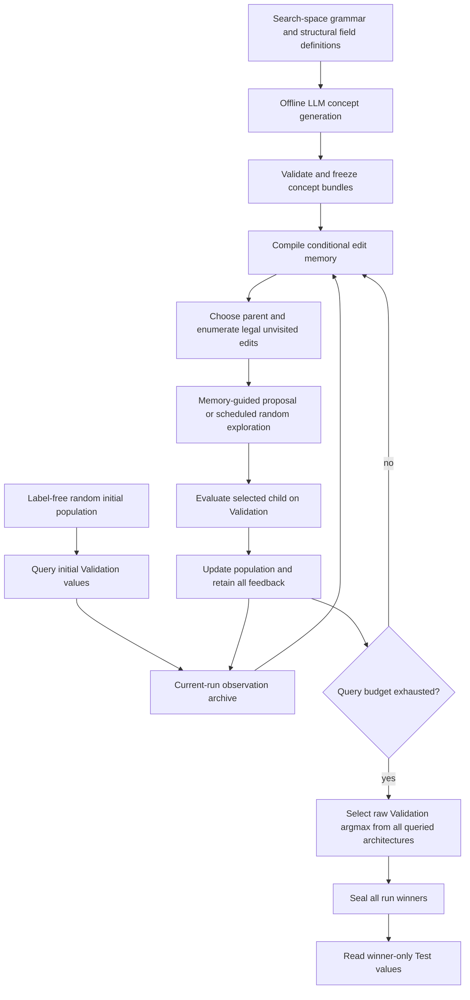

# SSME-NAS

Semantic edit memory for evolutionary neural architecture search.

> **Pre-publication code preview — intentionally incomplete.**
> This repository contains a documented search framework and selected controller
> components. The unpublished memory compiler, evidence retrieval/readout,
> mutation proposal implementation, native adapters, and benchmark readers are
> **not included**. The search entry point exits with an explicit
> `CoreNotReleasedError` before loading data or making requests.
> This is **not** a runnable reproduction package. Removing the entry-point
> guard does not restore the missing implementations.

## Method overview

SSME-NAS separates a fixed, offline semantic prior from the numerical experience
that an evolutionary search collects online. An LLM proposes bundles of native
structural fields from label-free structural examples. A deterministic validator
checks the bundles before they are frozen. The LLM does not supply measured
gains, candidate accuracies, or search-time decisions.

During search, the method records **every evaluated architecture**, including
unsuccessful mutations. It builds directed edit relations from observed endpoints
and compiles them into action-specific conditional partitions. Candidate edits
retrieve compatible observed experience, and a numerical readout guides which
mutation to evaluate next. Parent selection and survivor retention use only
validation values already available in the current run.



### Algorithm flow

1. **Offline semantic initialization.** Generate and validate search-space-specific
   concept bundles once; freeze them before search. No historical winner scores
   or target Test values are part of this initialization.
2. **Random initialization.** Sample distinct valid architectures without seeing
   their scores, then obtain their Validation measurements.
3. **Observed edit memory.** Keep the executed parent–child relations and complete
   nearby relations only when both endpoints have already been evaluated.
   Reverse relations are derived observations, not independent experiments.
4. **Conditional compilation.** Organize evidence by compatible directed action
   type and concept-defined structural context. Preserve positive, negative, and
   zero feedback. Concepts are fixed; numerical evidence and partitions evolve.
5. **Mutation selection.** Enumerate legal, unvisited native edits. Use scheduled
   random exploration or the highest strictly positive supported memory score,
   with deterministic identity-based ties. Fall back to random exploration when
   no positively supported action is available. No online LLM is called.
6. **Feedback and survival.** Query the selected child once. During bootstrap it
   competes with its own parent. After bootstrap, use validation-based parent
   tournaments and elite retention. All observed feedback enters memory even
   when a child does not survive in the active population.
7. **Final selection.** Select the highest **unrounded** Validation value among
   every queried architecture, break ties by canonical identity, and seal all
   run winners before reading winner-only Test measurements.

```text
concepts <- validate_and_freeze(offline_LLM(structural_examples))
archive, population <- evaluate(random_distinct_starts)
memory <- compile(archive, concepts)                    # withheld
while Validation query budget remains:
    parent <- bootstrap_schedule_or_tournament(population)
    child <- propose_legal_unvisited_edit(parent, memory) # withheld
    outcome <- Validation(child)                        # reader withheld
    append child and its actual outcome to archive
    population <- bootstrap_or_elite_retention(population, child)
    memory <- compile(archive, concepts)                 # withheld
winner <- raw_Validation_argmax(archive)
seal all run winners
report Test(winner)                                     # reader withheld
```

The memory score determines **what to query**, not an unmeasured claim that the
child is better. It is distinct from the measured Validation outcome used for
population survival. Test never participates in that loop.

## What is published?

| Included in this preview | Withheld before publication |
|---|---|
| Search-loop structure and information boundaries | Conditional memory compiler and observed-relation completion |
| Bootstrap, binary parent tournament, elite retention | Structural context encoding and native legal-neighbor adapters |
| Final Validation selection and winner-seal helpers | Contextual retrieval, numerical scoring, and mutation proposals |
| Explicit main-experiment configuration examples | Exact frozen concept artifacts and LLM-generation clients |
| Safety and controller unit tests | Benchmark tables/readers, private caches and experiment records |

See [release status](docs/RELEASE_STATUS.md) and
[source provenance](docs/PROVENANCE.md). Original private experiment archives
are not modified by this preview.

## Explicit benchmark configuration examples

These are the configurations selected for this preview, **not results produced
by running this public checkout**. The generic framework above is not limited
to these benchmark names or counts.

| Example | Validation queries/run | Initial population | Independent search seeds | Official evaluation |
|---|---:|---:|---:|---|
| NAS-Bench-101 / CIFAR-10 | 200 | 10 | 10 | budget 108, final Validation/Test |
| NAS-Bench-201 / CIFAR-10 | 100 | 10 | 10 | hp200, epoch index 199 |
| NAS-Bench-201 / CIFAR-100 | 100 | 10 | 10 | hp200, epoch index 199 |
| NAS-Bench-201 / ImageNet16-120 | 100 | 10 | 10 | hp200, epoch index 199 |

The initial queries are included in the per-run budget. Each architecture uses
the mean of all actually available official repeats; repeats are not independent
search runs. Winner-only Test reads and offline concept generation are accounted
for separately. Cached table reads do not remove logical query costs.

The configuration files in `configs/` describe evaluation contracts. They do not
contain seeds, source labels, credentials, benchmark tables, or hidden winners.
No score table is published here: this preview cannot independently reproduce
experimental accuracies.

## Inspecting the preview

Python 3.10 or later is sufficient for the public components. No GPU, benchmark
download, API credential, or third-party Python dependency is needed.

```bash
python run_search.py --describe
python -m unittest discover -s tests -v
```

Attempting the main experiment deliberately stops with an honest release notice:

```bash
python run_search.py --config configs/nb101_cifar10_q200.json
# Exit code 2: CoreNotReleasedError: unpublished core modules are not distributed.
```

The tests exercise controller mechanics, validation checks, and the release
boundary only. Passing them is **not** evidence that NAS experiments ran or that
the method improves accuracy. No benchmark or paid API request is made.

## Layout

```text
run_search.py             Explicitly disabled experiment entry point
ssme_nas/
  controller.py          Readable, gated search-loop integration scaffold
  parent_selection.py    Selected parent-selection component
  population.py          Selected survivor-retention component
  selection.py           Validation argmax and immutable winner seals
  contracts.py           Interfaces required from the private implementation
  private_core.py        Explicit missing-core errors; no fallback algorithm
configs/                 Main-experiment configuration examples
tests/                   Public component and release-boundary tests
docs/                    Release scope, provenance, and security policy
```

## Availability and security

- No API keys, authentication files, private host paths, experiment logs, model
  weights, benchmark data, or Git history from the private project are included.
- Do not put credentials in Git. No credentials are necessary for this preview.
- This is a limited source preview, **not an open-source release**. No open-source
  license is granted in this version; see [NOTICE](NOTICE.md).
- The complete implementation remains unpublished. No release date is promised.
  Publication of this preview does not establish priority, novelty, or a
  state-of-the-art performance claim.
- Official benchmark projects: [NAS-Bench-101](https://github.com/google-research/nasbench)
  and [NAS-Bench-201](https://github.com/D-X-Y/NAS-Bench-201).

## 中文说明

本仓库是 SSME-NAS 的发表前代码预览，不是完整复现包。保留主实验的进化
流程、父代选择、精英保留和评价边界；核心记忆编译、证据匹配、数值读出、
变异提案和基准读取模块暂不公开。启动主实验会明确报告缺失模块并停止，
不会制造假结果、调用付费接口或悄悄退化为随机算法。

LLM 只在离线阶段组织结构概念；搜索阶段的收益来自当前运行真实查询的
Validation。所有正负零反馈均保留，最终赢家只由 Validation 决定，封存后
才读取赢家 Test。上述公开框架与保留的单元测试不等于已公开完整科学实现。
